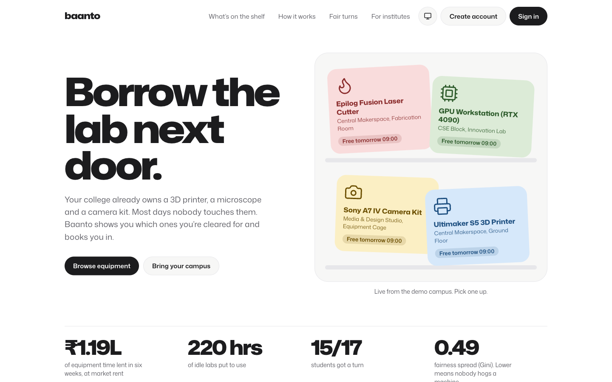
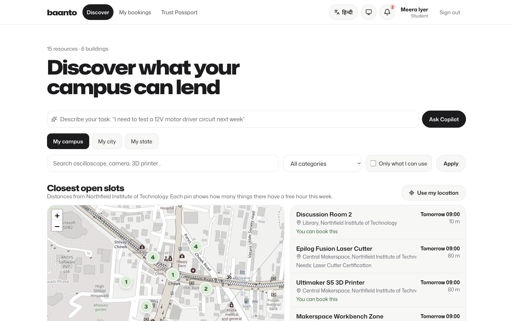
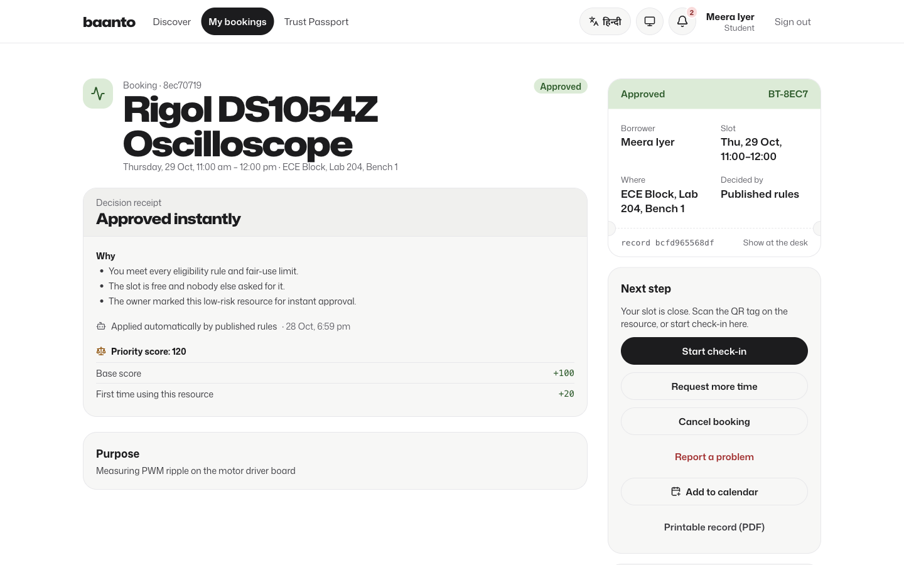
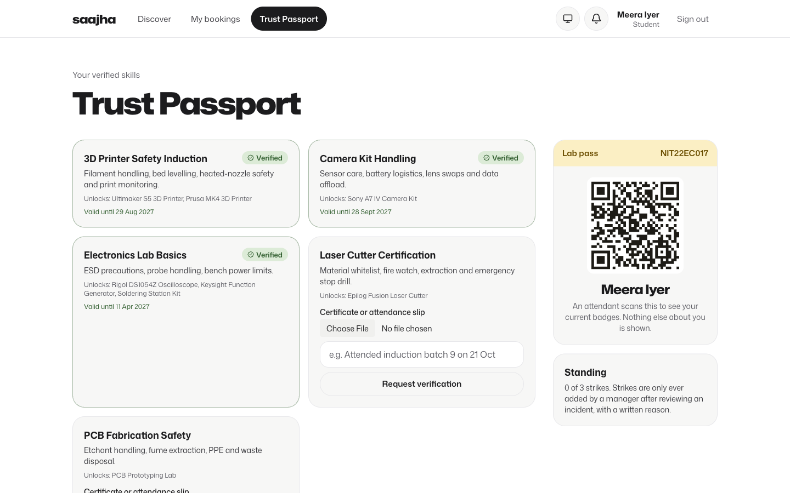
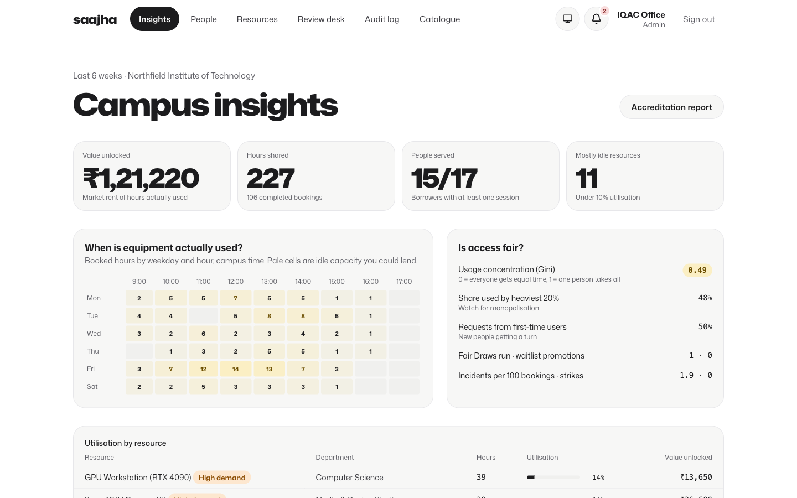
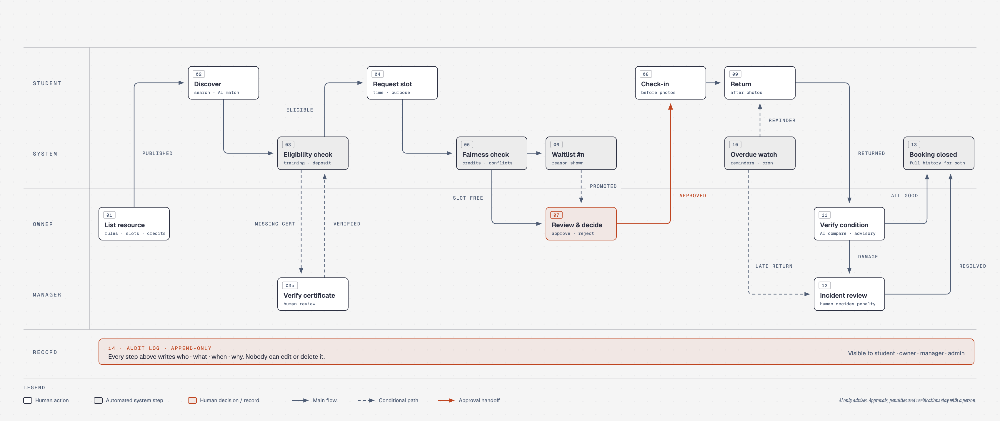

# Baanto

**Borrow the lab next door.** Baanto opens idle campus equipment and spaces to the students who need them. It shows what you're cleared to use and books you a slot. When too many people want the same hour, a fair draw that anyone can re-check decides.

Built for the problem statement **"Unlock Underused Equipment and Spaces"**.

**Live:** https://baanto-eight.vercel.app · **Judges:** start with the [testing guide](docs/judge-guide.md) · [Project document](docs/project-document.md)



## The problem

Indian colleges already own 3D printers, oscilloscopes, microscopes, camera kits and seminar rooms. Most of them sit idle for most of the week. Students who could use them don't know they exist, aren't sure they're allowed, or lose out to whoever asks first. Lab owners say no because they can't tell who is trained or who broke something.

Baanto fixes the trust problem, not just the booking:

| Worry | What Baanto does |
|---|---|
| "Am I allowed to use this?" | A **Trust Passport** of verified training badges. Every resource lists what it needs, and you're told exactly what's missing. |
| "Someone always grabs it first" | Popular slots go to a **Fair Draw**: seeded, weighted towards people who've had less time, sealed before anyone asks, and re-runnable by anyone. |
| "Who broke it?" | **Photo handovers** at pick-up and return, with condition agreed on both sides and a fair review for damage. |
| "Why was I rejected?" | Every decision comes with a **receipt** that lists the rules applied and the priority breakdown. |
| "Is any of this real?" | A **hash-chained audit log**, verifiable from the app, plus utilisation and fairness (Gini) reports for IQAC/NAAC. |

## Try it in 60 seconds

Open `/login` and use any demo account (password for all: `Saajha@2026`), or click a role card.

1. **Meera** (student, full passport): go to **Discover**. See the map of closest open slots, open a resource and request a slot.
2. **Aarav** (student, missing a badge): the same resource tells him exactly which training he lacks.
3. **Dr. Priya Nair** (lab owner): decide requests with the priority score shown, or run a Fair Draw on a contested slot.
4. **Ravi** (attendant): confirm a supervised pick-up with photos.
5. **IQAC Office** (admin): campus insights, fairness, the NAAC report for any academic year (with a CSV), and a check that the audit chain is intact. This account is also on the Baanto review team, so it sees **Institutes** (`/ops`), where new institutes are approved or suspended.
6. **Zoya** (student at the partner campus, Riverside) and **Riverside Admin Office**: borrowing across campuses. Zoya asks her own institute to endorse her for Northfield. Riverside's admin office endorses her for 30, 90 or 180 days, with a reason. She can then request Northfield's equipment, and Northfield's owners see "Guest from Riverside, endorsed until …" on her requests.

The one-click demo accounts are at the fictional *Northfield Institute of Technology, Pune*, apart from Zoya and the Riverside admin office at the partner campus, Riverside College of Engineering.

Six more fictional institutes fill the map: Lakeview (Pune), Harbourside Polytechnic (Mumbai), Banyan School of Design (Ahmedabad), Silverline (Bengaluru) and Pearl City (Hyderabad), each with real-looking equipment and opening hours. Tea Garden (Guwahati) is waiting in the review console, so there's something to approve. Their lab in-charges sign in as `owner@<slug>.demo` and their admin offices as `admin@<slug>.demo` (for example `owner@lakeview.demo`), with the same password. Riverside's lab in-charge is `owner@riverside.demo`.

Switch Discover to **My city** as Meera to see Lakeview and Riverside next to Northfield, or **My state** to add Mumbai.

| | |
|---|---|
|  |  |
|  |  |

## For any institute in India

Any college can register at `/institutions/new` in a few minutes:

- Choose the institute type, and its departments, starter training badges and fair-use policy are set up for it.
- New institutes work for their own campus straight away.
- An institute stays **pending review** and isn't shown to other campuses until the Baanto team has checked it. That check happens in the review console, against the institute's website and AISHE code.
- A suspended institute's people can't sign in, and see why.
- **Cross-campus endorsements:** a student borrows from a partner campus only when their home institute vouches for them, for a purpose and a set period. Their training carries over wherever the host has a badge of the same name. Both campuses' audit logs record it.
- Students sign up at `/signup`, pick their institute and roll number, and can browse at once. The admin office verifies them before they can borrow.
- Lab in-charges drop a pin on the map for each resource (or tap **I'm standing at it**), so Discover measures the distance to the right building.
- **Discover** can widen from *My campus* to *My city* or *My state*, and shows verified institutes nearby on the map.

## In Hindi

Tap **हिन्दी** in the header or on the sign-in page. The app shell, sign-in, sign-up, Discover (with the map), each resource page with its eligibility reasons, your bookings, the Trust Passport, the owner's request queue and the admin office's People page switch to Hindi, and the choice is remembered on that device. Hindi text uses Noto Sans Devanagari with looser line spacing, so the matras aren't clipped. Strings live in `messages/en.json` and `messages/hi.json`, and a unit test fails if a key or a `{placeholder}` is missing from either file.

## Bookings that look after themselves

- **Waitlist:** when someone cancels a held slot, the next person in line is moved in automatically, but only after the same eligibility and fair-use checks as a new request. Anyone passed over is told why. Everyone behind moves up a place and gets a notification. Entries whose slot has passed are closed by the database's own sweep job.
- **Weekly sessions:** a request can repeat at the same time for up to 8 weeks. Each week goes through the same checks and is decided on its own, and the form says which weeks went through and why any didn't.
- **Rooms by size:** spaces list how many people they hold, and Discover filters for a group size.
- **Worth a look:** the review desk lists anyone who used most of a scarce resource while others were turned away, and repeated no-shows, from the last four weeks. It's advice for a person to act on; nothing changes automatically.
- **No-shows free the slot:** if nobody has started check-in 15 minutes after an approved slot begins, the slot is released and offered down the waitlist under the usual checks. Nothing is penalised automatically: the no-show becomes an incident, and a manager decides whether it earns a strike.
- **Security deposits on the record:** the counter records each deposit taken (cash, UPI or card, with a reference). After the return, staff hand it back in full, or the owner or a manager keeps part of it with a written reason the borrower sees and can contest. Every step is in the booking's audit history.
- **Calendar:** every booking has **Add to calendar** (an `.ics` file with a 30-minute reminder), and **My bookings** exports them all at once. Waitlisted slots come in as tentative, so they don't block your day.
- **NAAC report:** admin offices get a printable report for any academic year (July to June), arranged around NAAC Criterion IV (Infrastructure and Learning Resources). It covers the facilities and how much each is used, the procedures for maintaining and using them (counted from records), month-by-month use, equitable access and sharing with partner institutes. A CSV of the facility table is included for IQAC's data templates.

## Running a real college

- **Import from spreadsheets** (`/admin/import`): upload the stock register as CSV and every row is checked first, with the exact problem and line number for anything wrong. Nothing is listed until you confirm. A second upload, the college's student register, verifies everyone whose roll number matches, and leaves anyone whose name clearly differs for a manual check. Templates with the right columns are one click away.
- **Idle equipment gets a nudge:** the admin office sees what was used for under 10% of its open hours in the last four weeks, with the one change most likely to help (turn on instant approval, open it to partner campuses, lower its demand level). One tap applies it and tells the owner. Every Monday morning the database also sends owners a summary of their quietest resources.
- **Next week's forecast:** what is already booked, or the recent weekly trend if that's higher. A resource full for weeks running is the case for buying a second one.
- **Planned maintenance:** owners block out downtime with a reason. New requests in that window are refused with the reason, Discover counts it as busy, and anyone already booked is told, with the next free slot.
- **Ratings:** after a return, the borrower rates the equipment and the handover. The resource page shows the average and recent comments, and a low rating tells the owner straight away.
- **Calendar feed:** subscribe once from your profile in Google Calendar, Apple Calendar or Outlook, and bookings stay up to date there. The link is private and can be replaced at any time.
- **Partner sharing per resource:** an owner can keep a resource for their own campus only. It's then hidden from partner campuses' Discover, and any request from outside is refused with the reason.
- **Sign in with Google** (optional): turn it on and new people finish sign-up by picking their institute and roll number, as usual.

## On phones

Baanto installs as an app ("Add to Home screen"). Once you've opened your Trust Passport on a phone, its QR still shows at the lab desk with no signal. The saved copy is removed as soon as you sign out. Every other page shows a clear offline notice instead of an error.

## How it's built

- **Next.js 15** (App Router, server actions, TypeScript strict) and **Tailwind CSS v4**.
- **Supabase** (Postgres, Auth, Storage, Realtime). Row-level security on every table. State changes go through SQL functions, so the rules hold even if the UI is bypassed.
- **Domain logic is pure and unit-tested**, in [`src/lib/domain`](src/lib/domain):
  - eligibility
  - fairness and priority
  - the Fair Draw (commit and reveal)
  - condition comparison
  - utilisation and Gini
  - next open slot and distance
  - waitlist order
  - calendar files (`.ics`)
  - academic years on the campus clock
- **Maps:** Leaflet with OpenStreetMap tiles, and geocoding from Nominatim. All free, no API keys.
- **Languages:** next-intl, with the language kept in a cookie, so URLs are the same in English and Hindi. The rules explain themselves with message codes, so the same reason can be shown in either language.
- **Installable app:** a web manifest and a hand-written service worker. No extra libraries.
- **Background jobs** run inside Postgres with `pg_cron` every 10 minutes: overdue returns, reminders an hour before a slot, and closing stale waitlist entries. A weekly job sends owners their idle-equipment summary.
- **AI (optional):** Gemini matches a free-text task ("I need to test a 12V motor driver") to resources. Without a key it falls back to keyword matching, and AI output is never a decision.
- **Design:** "Common Room". Mona Sans plus four pastel tags with fixed meaning: sage means cleared, butter means popular, rose means a problem, sky means information. Light and dark themes, reduced motion respected, built mobile-first.
- **Motion:** Motion (Framer), GSAP SplitText, and Lenis smooth scroll.



### Project layout

```
src/app/            routes: landing, auth, sign-up, institutes, (app) for signed-in pages
src/lib/domain/     pure rules and their tests
src/lib/services/   server-side use cases (bookings, handovers, governance, insights, privacy…)
src/components/     UI: ui.tsx primitives, common-room/, motion/, ui-kit/
src/i18n/           language config, the cookie switch, and rule-reason translation
messages/           en.json and hi.json
supabase/           migrations (schema, RLS, state machine, audit chain…), seed.sql and seed-institutes.sql
e2e/                Playwright smoke tests (desktop and phone)
```

## Run it locally

```bash
npm install
cp .env.example .env.local   # fill in the values below
npm run dev                  # http://localhost:3000
```

| Variable | Needed | What it is |
|---|---|---|
| `NEXT_PUBLIC_SUPABASE_URL` | yes | Your Supabase project URL |
| `NEXT_PUBLIC_SUPABASE_PUBLISHABLE_KEY` | yes | Publishable (anon) key |
| `SUPABASE_SECRET_KEY` | yes | Secret key, server only |
| `GEMINI_API_KEY` | no | Turns on AI matching in Discover |
| `NEXT_PUBLIC_DEMO_MODE` | no | `1` lets check-in happen at any time, for demos |
| `NEXT_PUBLIC_GOOGLE_AUTH` | no | `1` shows **Continue with Google** on sign-in and sign-up |
| `NEXT_PUBLIC_SITE_URL` | prod | The public address, for email links, QR codes and calendar feeds |
| `EMAIL_CONFIRMATION` | prod | `1` once Supabase sends mail through your domain: new accounts confirm their email, and **Forgot password** appears |
| `CRON_SECRET` | prod | Any long random string; Vercel sends it to the daily photo-retention job |
| `NEXT_PUBLIC_GRIEVANCE_NAME`, `NEXT_PUBLIC_GRIEVANCE_EMAIL` | prod | The grievance officer shown on the privacy page (DPDP Act) |
| `NEXT_PUBLIC_SENTRY_DSN` | no | Turns on error reports. Names, emails, roll numbers, cookies and form data are stripped first |
| `SENTRY_ORG`, `SENTRY_PROJECT`, `SENTRY_AUTH_TOKEN` | no | Upload source maps on Vercel, so error reports show real line numbers |

**Google sign-in:** in Google Cloud Console, create an OAuth client (Web application) with the redirect URI `https://<project-ref>.supabase.co/auth/v1/callback`. In Supabase, open Authentication → Sign In / Providers → Google, paste the client ID and secret, and add `http://localhost:3000/auth/callback` (and your deployed URL's `/auth/callback`) to Authentication → URL Configuration → Redirect URLs. Then set `NEXT_PUBLIC_GOOGLE_AUTH=1`.

**Database:** apply `supabase/migrations/*` in order, then run `supabase/seed.sql` for the demo campus (with the Supabase CLI: `supabase db reset`), and `supabase/seed-institutes.sql` for six more fictional institutes across Pune, Mumbai, Ahmedabad, Bengaluru, Hyderabad and Guwahati (one waits in the review console). Their lab in-charges sign in as `owner@<slug>.demo` and their admin offices as `admin@<slug>.demo`, all with the same password.

**Checks** (the same ones CI runs on every push). Node 24 is pinned in `.nvmrc`.

```bash
npm run typecheck && npm run lint && npm test && npm run build
```

**End-to-end smoke tests** (Playwright). They sign in with the demo accounts and only read data:

```bash
NEXT_DIST_DIR=.next-prod npx next build && NEXT_DIST_DIR=.next-prod npx next start -p 3100 &
npm run e2e
E2E_JOURNEY=1 npm run e2e -- e2e/journey.spec.ts   # the whole lifecycle; writes bookings to the demo campus
```

On the demo campus, check-in opens at any time so the whole journey can be tried whenever you test; real institutes keep the real window (30 minutes before the slot).

CI runs them too, once the repository has the three Supabase secrets.

## Going live

The demo campus and real colleges share one database. Every institute has an `is_demo` flag: demo people only ever see demo institutes and real people only real ones, nobody can sign up into the demo, and the database refuses an endorsement across the two. Demo sessions show a banner saying so, and demo accounts can't change the shared password.

**Checklist**

1. **Database:** apply every migration in `supabase/migrations`. The last one adds indexes, faster RLS and a nightly clean-up (notifications after six months, rate-limit counters after two days).
2. **Vercel:** import the repo, set the variables above (never `NEXT_PUBLIC_DEMO_MODE` in production), and deploy. `vercel.json` pins the Mumbai region, next to the Supabase project, and schedules `/api/cron/retention` daily to delete handover photos after a year.
3. **Supabase → Authentication → URL Configuration:** set the Site URL to your address, and add `https://<your address>/auth/confirm` and `/auth/callback` to the redirect URLs.
4. **Email (needs a domain):** verify the domain in Resend (SPF and DKIM records), then in Supabase → Authentication → Emails → SMTP use host `smtp.resend.com`, port `465`, user `resend`, and a Resend API key as the password, sending from `no-reply@<your domain>`. Paste `supabase/templates/confirm.html` and `recovery.html` into the "Confirm signup" and "Reset password" templates, turn on **Confirm email**, and set `EMAIL_CONFIRMATION=1`.
5. **Supabase → Authentication → Passwords:** turn on leaked-password protection (Pro plan).
6. **Baanto team:** add the people who review new institutes with `insert into platform_staff (user_id) values ('<their user id>');`. The demo IQAC account only reviews demo institutes.
7. **Monitoring:** point an uptime monitor (UptimeRobot is free) at `/api/health`. It returns 200 when the database answers, 503 when it doesn't.
8. **Security headers** are on for every page. The Content Security Policy starts in report-only mode; once a week of real use shows no violations in the browser console or Sentry, rename the header to `Content-Security-Policy` in `next.config.ts`.
9. **Backups:** the free Supabase plan keeps daily backups for 7 days. Move to Pro (point-in-time recovery) before a college depends on it.

## Security and privacy

- **Abuse limits:** sign-up, sign-in and institute registration are rate-limited per IP (and per email for sign-in). The counts are kept in Postgres, so they hold across server instances.
- **New institutes:** start pending and are hidden from other campuses until checked.
- **Students:** can't borrow until the admin office has checked their roll number. With `EMAIL_CONFIRMATION=1` they also confirm their email before they can sign in.
- **Rate limits** also cover password-reset and confirmation emails, spreadsheet imports, and AI matching (60 a day per IP, then keyword matching takes over).
- **Public pages** (the landing page and the share image) show counts and initials only, never names.
- **Your data (DPDP Act 2023):** people can download everything Baanto holds about them from their profile, and delete their account there. Deletion removes their name, roll number, certificates, notifications and pending requests, and stops sign-in. Past bookings and the audit chain stay without their name, because the institution must keep them. It's refused, with the reason, while they still have open bookings or incidents, own resources, or are the institute's only admin.
- **Offline copy:** the Trust Passport saved on a phone is wiped on sign-out.
- **The audit log** can only be appended to, and anyone can check that it hasn't been tampered with.

## What's next

- Hindi for every remaining screen (the landing page, the remaining admin pages, the check-in flow, and the reasons stored in decision receipts), then other Indian languages.
- WhatsApp and email reminders (these need a provider account; WhatsApp also needs Meta business verification).
- Deposits over UPI.
